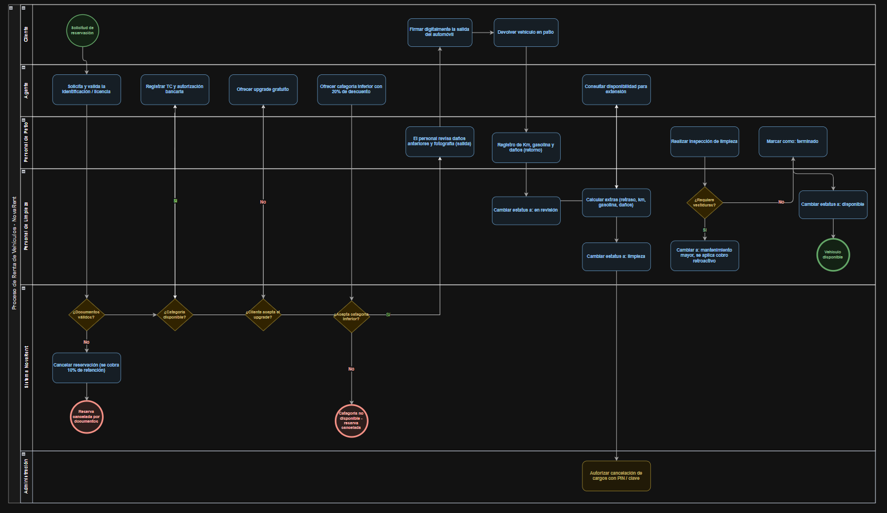

# BPMN — Proceso de renta de vehículos NovaRent

Carriles: Cliente · Agente · Personal de patio · Personal de limpieza · Sistema (Reglas del negocio) · Administración.

| Elemento del BPMN | Implementación |
|---|---|
| ¿Documentos válidos? = No → cancelar reservación (10 %) | `Reservacion.validar_documentacion` / `POST …/validar-documentacion` |
| ¿Categoría disponible? → upgrade → categoría inferior (20 %) | `CompensacionDeCategoria` / `POST …/compensacion` |
| Registrar TC y autorización bancaria | `VoucherAbierto`, `PasarelaDeAutorizacionBancaria` |
| Patio revisa daños y fotografía · Firmar digitalmente la salida | `InspeccionDeVehiculo`, `ContratoDeRenta.crear` / `POST …/entrega` |
| Devolver vehículo · Registro de km, gasolina y daños | `POST /contratos/{id}/devolucion` |
| Calcular extras (km, gasolina, daños) | `CalculadoraDeCargosExtra` + 3 `PoliticaDeCargo` |
| Cambiar estatus a "En revisión" → "Limpieza" | `Vehiculo.recibir_en_revision`, `iniciar_limpieza` |
| ¿Requiere vestiduras? → Mantenimiento Mayor (cargo retroactivo) | `Vehiculo.reportar_mantenimiento_mayor` + `ManejadorMantenimientoMayor` |
| Marcar "Terminado" → "Disponible" | `Vehiculo.marcar_terminado` |
| Autorizar cancelación de cargos con PIN (Administración) | `CargoExtra.cancelar(Rol.ADMINISTRACION)` (PIN pendiente) |

**Corrección H-8:** en el BPMN original "Calcular extras" aparece en el carril de Personal de Limpieza; en la implementación el cálculo lo hace el **Sistema** (`CalculadoraDeCargosExtra`).
