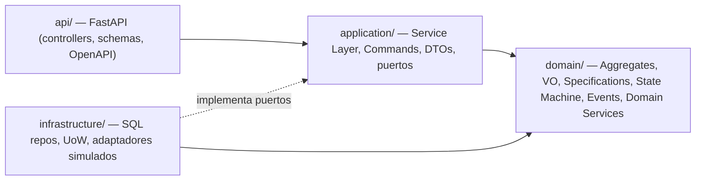
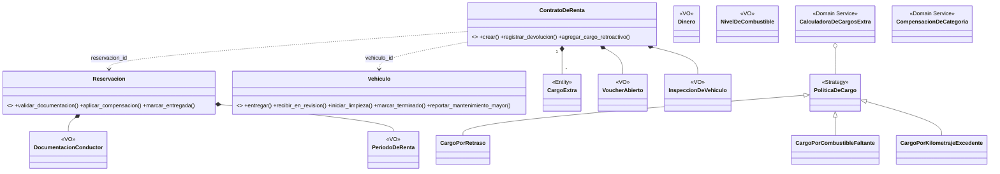
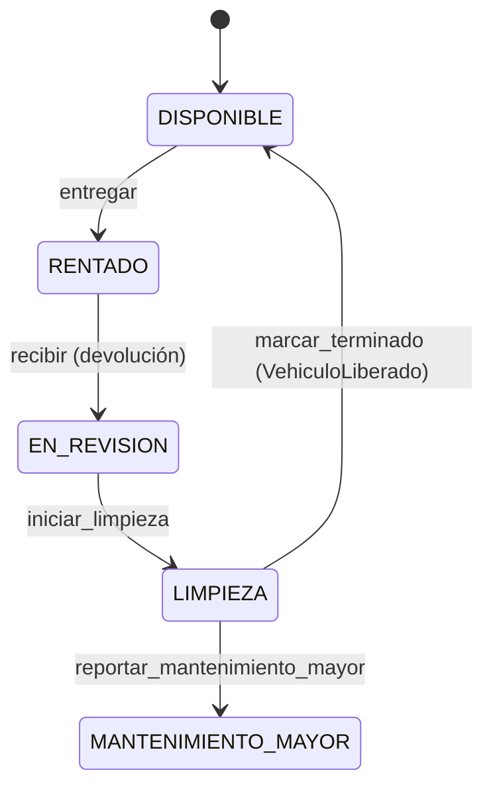

# Arquitectura de NovaRent
Origen: Actividad U3 del equipo (mapa de dominio, Service Layer, Repository/UoW, CQRS, SOLID, ADR). Este documento muestra **cómo quedó en el código**.

## 1. Capas y dependencias

Regla de dependencia: `domain` no importa nada de `application`, `infrastructure` ni `api` (verificable con `grep -r "import" src/domain`).

## 2. Modelo de dominio (DDD)

Los Aggregates se relacionan **solo por id** (ADR-02). Diagramas completos de la U3: [mapa de dominio](diagramas/fig1_mapa_de_dominio.png), [clases de dominio](diagramas/fig2a_clases_dominio.png), [clases de aplicación e infraestructura](diagramas/fig2b_clases_aplicacion_infraestructura.png), [secuencia CU-01/CU-02](diagramas/fig3_secuencia_entrega_CU01_CU02.png), [secuencia CU-04](diagramas/fig4_secuencia_devolucion_CU04.png).

## 3. State Machine del Vehículo (`src/domain/vehiculo.py`)

Cualquier otra combinación lanza `TransicionInvalida` → HTTP 409.

## 4. Patrones aplicados y por qué
| Patrón | Dónde | Justificación (evidencia del caso) |
|---|---|---|
| Domain Model | `src/domain` | Las reglas (N2, N3, N4) interactúan entre conceptos y requieren invariantes (ADR-01) |
| Specification (AND/OR/NOT) | `domain/specifications.py` | Reglas combinables y reutilizables: `documentacion_valida = Edad & Licencia & Identificación`; `existe_alternativa = ~HayEnCategoria & (Superior \| Inferior)` |
| State Machine | `domain/vehiculo.py` | El ciclo del vehículo es el corazón de N2/US11; tabla de transiciones explícita |
| Strategy | `PoliticaDeCargo` | Tres fórmulas de cargo intercambiables; una nueva (p. ej. daños) no toca `ContratoDeRenta` |
| Repository + Unit of Work | `application/ports.py`, `infrastructure/sql_repos.py` | Dominio sin SQL; una transacción por caso de uso (ADR-03) |
| Domain Events | `domain/events.py` + `PublicadorEnMemoria` | Publicados después del commit; `MantenimientoMayorRegistrado` dispara el cargo retroactivo |
| Service Layer / CQRS básico | `application/services.py`, `commands.py`, `dtos.py` | Commands cambian estado y devuelven un id; Queries devuelven DTOs |
| Dependency Injection (Composition Root) | `api/container.py` | Configuración por variables de entorno (12-Factor) |

## 5. SOLID — evidencia en el código
| Principio | Evidencia |
|---|---|
| **S** | `Vehiculo` solo gestiona su ciclo de vida; `CalculadoraDeCargosExtra` solo calcula; los servicios solo coordinan (no contienen fórmulas) |
| **O** | Agregar un cargo nuevo = una clase `PoliticaDeCargo` nueva, sin modificar `ContratoDeRenta` ni la calculadora |
| **L** | Los repos SQL y en memoria son intercambiables: los mismos servicios pasan las pruebas con ambos (`tests/unit/test_servicios.py` vs `tests/integration/test_api.py`) |
| **I** | Puertos pequeños: `Reloj`, `ProveedorDePrecioDeCombustible`, `PasarelaDeAutorizacionBancaria`, `CatalogoDeCategorias` |
| **D** | La Service Layer depende de `ports.py` (abstracciones); `container.py` inyecta las implementaciones concretas |

**Hallazgo SOLID corregido (U3):** `registrar_devolucion` devolvía el resumen de cargos mezclando comando y consulta; ahora devuelve solo `contrato_id` y el resumen se obtiene con `GET /contratos/{id}/cargos`.

## 6. Decisiones (ADR)
[ADR-01](ADR-01-domain-model.md) · [ADR-02](ADR-02-aggregates-separados.md) · [ADR-03](ADR-03-transaccion-por-caso-de-uso.md) · [ADR-04](ADR-04-stack-tecnologico.md)

## 7. Desviaciones respecto al diseño de la U3 (honestas)
- Las Queries `panel` y `resumen de cargos` usan los repositorios + DTOs (no puertos de lectura `LectorDe…` separados). Es una simplificación; el modelo de lectura sigue desacoplado del de escritura mediante DTOs.
- `PublicadorDeEventos` es en memoria (no hay bus externo): suficiente para la demostración.
